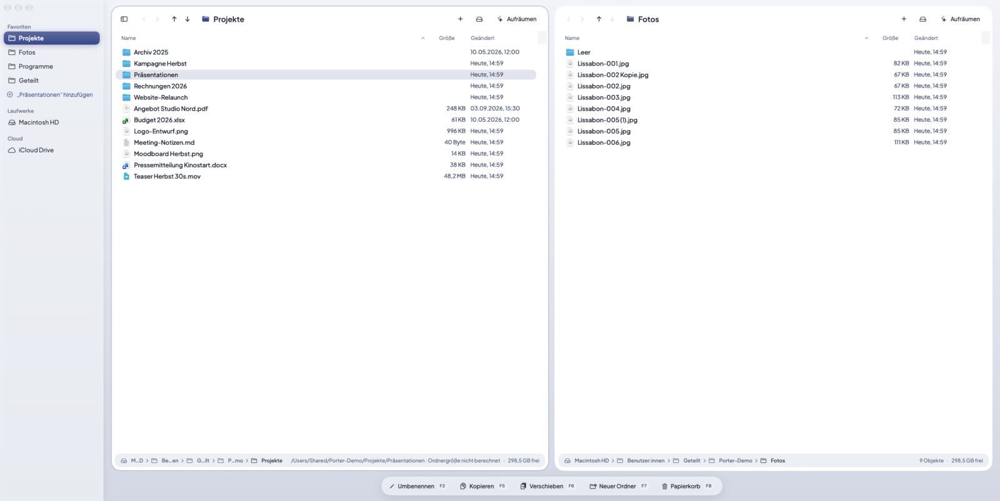
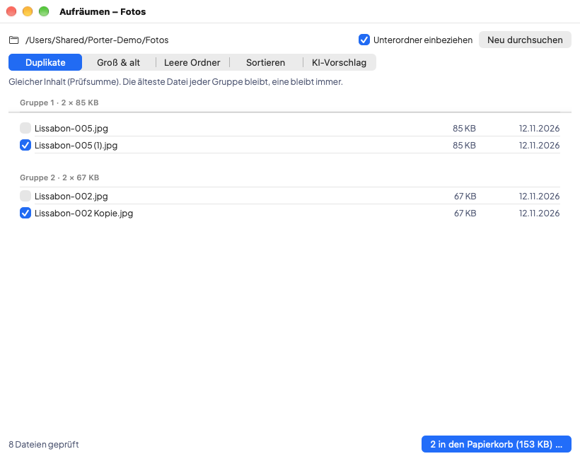
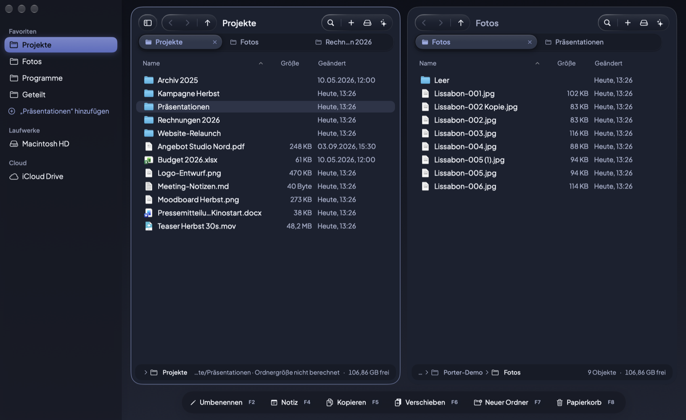

# Porter

Porter ist ein Dateimanager mit zwei Spalten für macOS 27. Links ein Ordner, rechts ein Ordner, und eine Datei wandert mit einem Tastendruck hinüber. Wer früher mit dem Norton Commander oder Total Commander gearbeitet hat, kennt das Prinzip. Gelöscht wird nie endgültig: Alles, was weg soll, landet im Papierkorb.

## Was Porter kann

### Zwei Spalten
- Tab wechselt die Spalte. F5 kopiert, F6 verschiebt, F2 benennt um, F7 legt einen Ordner an, F8 wirft in den Papierkorb. Liegt am Ziel schon eine Datei mit dem Namen, fragt Porter vorher.
- Jede Spalte hat Tabs, Zurück und Vor und eine Pfadleiste, deren Glieder man anklicken kann. Die Leertaste öffnet Quick Look.
- In der Seitenleiste stehen deine Favoriten (hineinziehen, umsortieren), die Laufwerke mit Auswerfen-Knopf und iCloud sowie andere Cloud-Ordner.
- Sortieren per Klick auf den Spaltenkopf, gruppieren nach Art, Datum oder Größe. Jede Spalte merkt sich ihre eigene Ansicht.

### Aufräumen

- Porter findet Duplikate über die Prüfsumme, die älteste Datei bleibt stehen. Außerdem große Dateien, die du lange nicht geöffnet hast, und leere Ordner.
- Auf Wunsch sortiert Porter einen Ordner in Unterordner, nach Art oder nach Monat.
- Der KI-Vorschlag nutzt Apples Sprachmodell auf deinem Mac. Es sieht nur die Dateinamen, und nichts verlässt den Rechner. Perfekt ist es nicht (im Test landete ein Passwort-Notfallblatt bei den Rechnungen), deshalb siehst du jede Zuordnung vorher und kannst sie ändern.
- Vor jedem Schritt zeigt Porter, was passieren wird. Verschieben lässt sich rückgängig machen, und Gelöschtes holst du aus dem Papierkorb zurück.

### Umwandeln, packen, umbenennen
- Bilder werden zu JPG, PNG, WebP, HEIC oder AVIF, auf Wunsch kleiner gerechnet. Aus Bildern wird SVG oder ein PDF, aus PDF-Seiten werden Bilder.
- Packen geht als ZIP, als ZIP mit Passwort (AES-256) oder als verschlüsseltes DMG. Das Passwort speichert Porter nirgends.
- Viele Dateien auf einmal umbenennen: neuer Name, Suchen und Ersetzen, laufende Nummern, Datum, Kleinschreibung, Unterstriche statt Leerzeichen. Mit Vorschau, und der letzte Durchgang lässt sich zurücknehmen.

### Kleinkram, der im Alltag zählt
- Der Rechtsklick kann, was man vom Finder kennt: Öffnen mit, Teilen, Dienste, Pfad kopieren, Terminal hier öffnen, Informationen.
- Ein Symbol in der Menüleiste führt zu Favoriten und Laufwerken. Wer es nicht mag, schaltet es ab.
- command-Plus und command-Minus machen die Schrift größer oder kleiner. Porter merkt sich die Größe.
- Läuft auch auf kleinen Bildschirmen. Getestet an einem Monitor mit 1344 × 504 Punkten: Das Fenster passt drauf, und im Vollbild bleiben die Knöpfe oben erreichbar. Wird das Fenster schmal, wandern Neuer Tab, Orte und Aufräumen in ein „…“-Menü.
- Hell und dunkel, passend zum System.

## Installieren

1. Unter [Releases](https://github.com/miwixyz/Porter-Updates/releases) die neueste `Porter-vX.Y.Z-macOS.zip` laden.
2. Entpacken und `Porter.app` in den Ordner *Programme* ziehen.
3. Damit Porter in alle Ordner schauen darf: *Systemeinstellungen → Datenschutz & Sicherheit → Festplattenvollzugriff*, dort Porter einschalten.

Porter braucht macOS 27. Die App ist mit einer Apple Developer ID signiert und von Apple notarisiert. Auf Mac-Tastaturen drückst du die F-Tasten zusammen mit fn, außer du hast sie in den Systemeinstellungen als Standardtasten eingestellt.

## Updates

In der App unter **Porter → Nach Updates suchen …**. Beim zweiten Start fragt Porter einmal, ob es selbst nach Updates suchen darf. Jedes Update trägt zwei Signaturen (EdDSA und Apple Developer ID). Porter installiert nur, was beide Prüfungen besteht, und eine veränderte Update-Liste lehnt es ab.

## Datenschutz

Porter schickt nichts über dich oder deine Dateien irgendwohin. Es gibt kein Konto und keine Nutzungsstatistik. Die einzige Verbindung ins Netz ist die Update-Suche hier bei GitHub.

## Was in diesem Repo liegt

Nur die fertigen, notarisierten Versionen (unter *Releases*) und die signierte Update-Liste `appcast.xml`. Der Quellcode von Porter ist nicht öffentlich. Die Bilder oben zeigen einen Demo-Ordner.

Alle Rechte vorbehalten © 2026 Michael Wildenauer.
